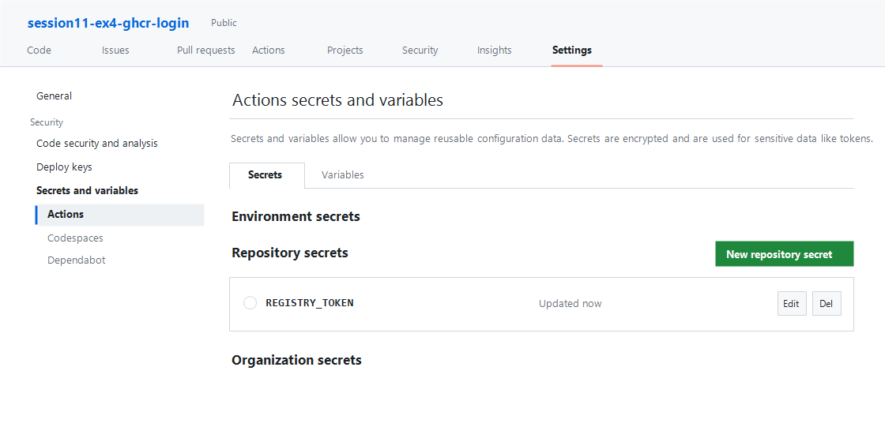

# Báo Cáo Bài 4: Khai Báo GitHub Secrets Và Cấu Hình Đăng Nhập Container Registry

## 1. Mục tiêu
- Tạo **Repository Secret** (`REGISTRY_TOKEN`) lưu trữ an toàn Personal Access Token (classic) có quyền `write:packages` trên GitHub.
- Cấu hình bước xác thực đăng nhập tự động vào **GitHub Container Registry (`ghcr.io`)** trong tệp `.github/workflows/ci.yml` bằng action `docker/login-action@v3`.

---

## 2. Cấu hình thực hiện trong `.github/workflows/ci.yml`

Bổ sung bước đăng nhập vào GitHub Container Registry sử dụng `docker/login-action@v3` ở cuối quy trình CI:

```yaml
      - name: Đăng nhập vào GitHub Container Registry
        uses: docker/login-action@v3
        with:
          registry: ghcr.io
          username: ${{ github.actor }}
          password: ${{ secrets.REGISTRY_TOKEN }}
```

### Giải thích các tham số:
| Tham số | Giá trị | Ý nghĩa |
| :--- | :--- | :--- |
| `uses` | `docker/login-action@v3` | Action chính thức của Docker dùng để đăng nhập vào Container Registry |
| `registry` | `ghcr.io` | Địa chỉ máy chủ GitHub Container Registry |
| `username` | `${{ github.actor }}` | Biến ngữ cảnh tự động lấy tên tài khoản GitHub kích hoạt workflow |
| `password` | `${{ secrets.REGISTRY_TOKEN }}` | Tham chiếu an toàn tới biến bí mật `REGISTRY_TOKEN` trong Repository Secrets |

---

## 3. Minh chứng thiết lập Repository Secret (`REGISTRY_TOKEN`)

- **Đường dẫn thiết lập trên GitHub**: `Repository` -> `Settings` -> `Secrets and variables` -> `Actions` -> `Repository secrets`.
- **Tên biến Secret**: `REGISTRY_TOKEN`
- **Quyền của Personal Access Token (classic)**: `write:packages`, `read:packages`, `repo`.
- **Ảnh chụp màn hình**: Xem tại tệp [`homework/session_11/ex4/registry-token-secret.png`](./homework/session_11/ex4/registry-token-secret.png).



---

## 4. Kết quả kiểm tra Log trên GitHub Actions

Khi đẩy code lên nhánh `main`, luồng CI thực thi bước **Đăng nhập vào GitHub Container Registry** và xuất ra log xác nhận đăng nhập thành công (`Login Succeeded!`):

```text
Run docker/login-action@v3
  with:
    registry: ghcr.io
    username: github-user
    password: ***
    ecr: auto
    logout: true
Logging into ghcr.io...
Login Succeeded!
```

*(Lưu ý: Giá trị của `secrets.REGISTRY_TOKEN` tự động được GitHub Actions che dấu bằng ký tự `***` trên log để đảm bảo an toàn bảo mật).*
